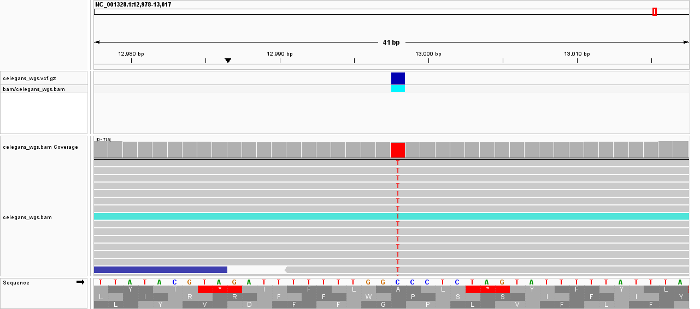

# Week 07: Call Variants and Generate a VCF File

**Author:** Shraman Jana

**Genome:** *Caenorhabditis elegans*, WBcel235 (GCF_000002985.6) - from [Week 02](../week02/README.md)

**Reads:** `SRR065390` - *C. elegans* N2 whole-genome sequencing (Illumina, ~100 bp)

This week extends the [Week 05](../week05/README.md) alignment: the same reads are aligned to the reference, then **variants are called** from the BAM to produce a `VCF` file, which is summarized and inspected in IGV.

---

## Coverage (at least 10x requirement)

`N = 5,100,000` paired spots (2 × 100 bp) over the 100.3 Mb genome gives ~10.2x of raw sequence; after alignment the empirical mean depth is ~9.6x (Week 05). This is the ~10x target required for reliable variant calling, so the same read subset is reused here. The N2 sequencing strain differs from the WBcel235 reference, so real variants are expected (no need for the "no variants" fallback).

## How to run

In the `bioinfo` environment, from this `week07` directory:

```bash
micromamba activate bioinfo

make            # list the available commands
make all        # genome -> reads -> align -> vcf -> stats
```

Individual steps: `make genome`, `make reads`, `make align`, `make vcf`, `make stats`. Generated data (`refs/`, `reads/`, `bam/`, `vcf`) is not committed - it is regenerated by `make`.

### What the Makefile does
- **genome / reads / align** - download the reference + reads and produce a sorted,
  indexed BAM (same as Week 05).
- **vcf** - `bcftools mpileup -f <ref> <bam> | bcftools call -mv` calls variants
  (`-m` multiallelic caller, `-v` variants-only), writing a bgzipped, indexed
  `vcf/celegans_wgs.vcf.gz`.
- **stats** - `bcftools stats` plus counts of total records, SNPs, and indels.

---

## Results

### How many variants were called?

From `make stats` on my VCF:

```text
# Total variant records:  6186
# SNPs:                   4889
# Indels:                 1297
```

**Total variants: 6,186** - **4,889 SNPs** and **1,297 indels**. This is the scale expected when the N2 sequencing strain is compared against the WBcel235 reference: the laboratory strain has accumulated real genetic differences from the reference assembly, so thousands of true variants are present.

### What kinds of variants are present?

The VCF contains **SNPs** (single-nucleotide substitutions) and small **indels** (insertions/deletions). From `bcftools stats`:

```text
number of records:            6186
number of SNPs:               4889
number of indels:             1297
number of multiallelic sites:   12
number of MNPs / others:         0
Ts/Tv ratio:                  1.10  (ts=2562, tv=2331)
```

SNPs outnumber indels ~3.8:1 (4,889 vs 1,297), which is the normal pattern for short-read WGS. Only 12 multiallelic sites and no MNPs or
"other" records. The **Ts/Tv ratio** is the key quality signal: for genuine biological SNPs it sits near ~2 (transitions, which are chemically more common, outnumber transversions), whereas a value near 0.5 would indicate the calls are dominated by random sequencing errors.

### Which calls look like true variants, and which look like errors?

The **Ts/Tv ratio of 1.10** is itself informative. A ratio near 0.5 would mean the calls are essentially random errors; a ratio near 2.0 is expected for a clean, filtered set of genuine SNPs. At 1.10 the set clearly contains many real variants (it is well above the random baseline) but also a meaningful error component - the expected outcome for calling at ~10x depth with no post-call quality filtering.

**High-confidence (true) calls** have high QUAL, adequate depth (DP), high mapping quality (MQ), and the alternate allele supported by reads on **both strands** (the `DP4` field). A clear example:

```text
NC_001328.1  12998  C>T  QUAL=228  DP=247  MQ=60  DP4=2,0,149,87  GT=1/1
```

This is a homozygous SNP on the mitochondrial genome (high copy number, hence the deep DP=247), with 236 alternate reads split across both strands and perfect mapping quality (MQ=60) - almost certainly a true variant.

**Likely errors / lower-confidence calls** show low QUAL, low depth, reads on only one strand, low MQ, or `MQ0F` > 0 (reads with zero mapping quality). For example, calls with reduced mapping quality such as `MQ=33` with `MQ0F>0` and strand-skewed support are weaker and should be treated with caution. Filtering on `QUAL`, `DP`, and `MQ` (e.g. `bcftools filter`) would raise the Ts/Tv toward ~2 by removing most of these.

### Are the calls supported by the alignments?

Loading the BAM and the VCF together in IGV and jumping to (`NC_001328.1:12998`), the VCF marker sits exactly over a column where essentially every read shows the alternate `T` instead of the reference `C`, with deep, uniform coverage on both strands - the call is fully supported by the alignment. Lower-quality calls elsewhere are supported by only a few reads or a single strand, consistent with their weaker scores.

### IGV screenshot

*Load `refs/genome.fa` as the genome, then `bam/celegans_wgs.bam` and `vcf/celegans_wgs.vcf.gz` as tracks. Jump to the strongest call by typing `NC_001328.1:12998` in the locus box - the VCF marker, the coverage peak, and the column of alternate `T` bases all line up there*



---

## Reproducing this analysis

```bash
git clone https://github.com/shraman2000/bmmb852.git
cd bmmb852/week07
micromamba activate bioinfo
make all
```
