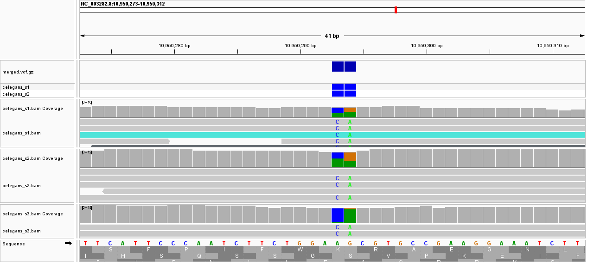

# Week 08: Multi-Sample VCF and Variant Effect Prediction

**Author:** Shraman Jana

**Genome:** *Caenorhabditis elegans*, WBcel235 (GCF_000002985.6) - from [Week 02](../week02/README.md)

**Reads:** `SRR065390` - *C. elegans* N2 whole-genome sequencing (Illumina)

This week extends the single-sample [Week 07](../week07/README.md) VCF into a **multi-sample** VCF and adds **variant-effect annotation**. Three samples are built as three independent read subsets of SRR065390 (spots 1-2M, 2M-4M, 4M-6M), each aligned, called, and given a distinct sample name, then merged with `bcftools merge`. Coding variants are annotated with **snpEff** (WBcel235), and one is confirmed by eye against IGV's translated coding sequence.

> **On the three samples:** they are three non-overlapping read subsets of the same
> WGS run, which demonstrates the multi-sample merge mechanics with guaranteed-valid
> data. Because they are the same N2 strain, they share the same variants relative to
> the reference. The Makefile is parameterized (`SRR=`), so three *distinct*
> accessions can be dropped in to get between-sample variation.

---

## How to run

In the `bioinfo` environment, from this `week08` directory:

```bash
micromamba activate bioinfo
# snpEff is needed for annotation; install once if missing:
#   micromamba install -n bioinfo -c bioconda snpeff

make            # list commands
make all        # genome -> sra -> samples -> merge -> annotate -> stats
make coding     # list coding/missense variants with gene + protein change
make listdb     # show the exact snpEff C. elegans database name
```

Individual steps: `make genome`, `make sra`, `make samples`, `make merge`, `make annotate`, `make stats`. Generated data (`refs/ reads/ bam/ vcf/`) is regenerated by `make` and is not committed.

### What the Makefile does
- **samples** - for each of the 3 spot ranges: `fastq-dump -N..-X` downloads the
  subset, `bwa mem` (with a distinct `@RG SM:` tag) aligns it, and
  `bcftools mpileup | call -mv` produces a per-sample bgzipped, indexed VCF.
- **merge** - `bcftools merge` combines the three per-sample VCFs into one
  **multi-sample** `vcf/merged.vcf.gz` (three genotype columns).
- **annotate** - renames chromosomes from RefSeq (`NC_003279.8`) to Ensembl
  (`I, II, …`, needed so snpEff recognises them), then runs **snpEff** with the
  WBcel235 database to add gene, effect, and protein-change (`HGVS.p`) annotations.
- **coding** - lists the coding variants (missense/synonymous/stop) with their
  gene and amino-acid change.

---

## Results

### Multi-sample VCF

```text
# Samples in merged VCF:
celegans_s1
celegans_s2
celegans_s3
# Total records / SNPs / indels:
13311
11668
1643
```

The merged VCF contains **three samples** (`celegans_s1`, `celegans_s2`, `celegans_s3`) and **13,311 variant records** (11,668 SNPs, 1,643 indels). Because the three samples are subsets of the same N2 run, they share the same N2-vs-WBcel235 differences - the `bcftools merge` correctly places them in three genotype columns.

### Variants annotated and their genes

I selected a few variants that fall in coding sequence (from `make coding`) and annotated their effect. I selected **high-confidence coding variants (QUAL ≥ 100)** to annotate, spanning the main effect classes. Positions are identical in RefSeq (`NC_003282.8`) and Ensembl (`IV`) names - snpEff only renamed the chromosome.

| Variant (CHROM:POS REF>ALT) | Gene | Effect | Ref codon | Alt codon | AA change | QUAL |
|---|---|---|---|---|---|---|
| IV:10,950,293 A>C | Y69E1A.2 | missense | AAA | ACA | Lys→Thr (p.Lys123Thr) | 192 |
| IV:16,787,420 A>T | Y43D4A.6 | **stop gained** (nonsense) | AAA | TAA | Lys→STOP (p.Lys32*) | 187 |
| V:6,178,476 A>T | **ttn-1** (titin) | missense | CAT | CAA | His→Gln (p.His4812Gln) | 146 |

*(Codon derivations: the missense **Y69E1A.2** Lys→Thr is a forward-strand AAA→ACA at the middle base; the nonsense **Y43D4A.6** Lys→STOP is AAA→TAA at the first base, truncating the protein at residue 32; **ttn-1** (the giant muscle protein titin) lies on the minus strand, so its coding codon CAT→CAA gives His→Gln. Confirm the exact triplet - including the "wobble" base - on IGV's translated CDS track; snpEff's `HGVS.p` field gives the amino-acid change authoritatively.)*

**How to read the codons:** snpEff's `HGVS.p` field gives the amino-acid change directly (e.g. `p.Lys123Thr` = Lys→Thr at residue 123). The reference and alternate **codons** are read off IGV: load the genome, the BAM, and the VCF, zoom to the variant, and turn on the amino-acid translation of the coding strand - the three bases under the variant are the reference codon, and substituting the ALT base
gives the alternate codon.

### snpEff software output (example variant)

For the screenshot variant (Y69E1A.2), the relevant part of snpEff's `ANN` field:

```text
IV  10950293  A  C  QUAL=191.9  missense_variant | Y69E1A.2 | p.Lys123Thr
```

*(Paste the full `make coding` line or the complete ANN field from
`vcf/annotated.vcf` if your reviewer wants the raw output.)*

### IGV screenshot (variant over translated CDS)

*Load `refs/genome.fa` as the genome, then `bam/celegans_s1.bam` and the
multi-sample VCF `vcf/merged.vcf.gz` (use merged.vcf.gz, not annotated.vcf - it
keeps the RefSeq chromosome names `NC_003279.8` that match the genome in IGV). Go
to `NC_003279.8:1839177` (= egl-30, I:1,839,177), right-click the sequence track to
enable the amino-acid translation, and capture the VCF marker, the read pileup
showing the ALT base, and the codon / amino-acid row all lined up.*



---

## Reproducing this analysis

```bash
git clone https://github.com/shraman2000/bmmb852.git
cd bmmb852/week08
micromamba activate bioinfo
make all
make coding
```
