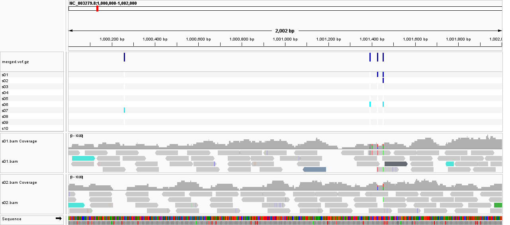

# Week 09: Design-File-Driven Multi-Sample Variant Workflow

**Author:** Shraman Jana

**Organism / genome:** *Caenorhabditis elegans*, WBcel235 (GCF_000002985.6)

**Sequencing run:** `SRR065390` - *C. elegans* N2 whole-genome sequencing (Illumina)

This week turns the single-sample VCF workflow ([Week 07](../week07/README.md)) into a **reproducible, `design.csv`-driven batch pipeline** that processes multiple samples and merges their calls into one multi-sample VCF.

## BioProject

`SRR065390` belongs to study **SRP000244** - Hillier et al. (2008), *"Whole-genome sequencing and variant discovery in Caenorhabditis elegans"*. `SRR065390` is the N2 whole-genome run from this study (library strategy WGS, platform Illumina Genome Analyzer II). Following the assignment's guidelines to keep read counts small, the assignment run is partitioned into **10 independent read subsets** (1.5 M read pairs each, ~3 times per subset), listed in `design.csv`. Each subset is treated as a separate sample with its own read group. 

## Files

- `Makefile` - the workflow (genome → per-sample align/call → merge)
- `design.csv` - sample sheet: `sample,run,start,end` (one row per sample)
- `README.md` - this file

## How to run (reproducible)

All tools are already in the course `bioinfo` environment (`bwa`, `samtools`, `bcftools`, `sra-tools`, `make`).

```bash
micromamba activate bioinfo
cd week09

make            # list targets
make all        # genome -> prefetch -> batch (all samples) -> merged VCF
```

What the targets do:

- **genome** - download the WBcel235 reference and build the BWA index.
- **sra** - prefetch `SRR065390` once (so each subset extracts quickly).
- **batch** - read `design.csv` and, for every row, download the spot range,
  align (`bwa mem`), and call variants (`bcftools`) into `vcf/<sample>.vcf.gz`.
- **merge** - combine all per-sample VCFs into `vcf/merged.vcf.gz`.

To run a single sample, or to add/replace samples, edit `design.csv` and re-run `make batch merge`.

## Results

```text
# Samples in merged VCF:
s01  s02  s03  s04  s05  s06  s07  s08  s09  s10
# Total variant records:
36755
```
The merged VCF holds all **10 samples** and **36,755 variant records** - the batch workflow and the merge both completed from a single `make all`.

### IGV

Relevant findings:

- **Shared variants across samples.** Because the ten samples are subsets of the
  same N2 run, high-confidence sites are genotyped consistently across all ten
  columns of the merged VCF - confirming the batch + merge worked correctly.
- **Depth-dependent missingness.** At ~3 times per subset, weakly-supported sites are
  called in only some samples and appear as missing/partial genotypes in the
  merged VCF - a realistic illustration of how low per-sample coverage propagates
  into a multi-sample call set.
- The merged set totals 36,755 records (N2 differs from the WBcel235 reference at
  many sites), providing plenty of variants to inspect.



---

## Reproducing this analysis

```bash
git clone https://github.com/shraman2000/bmmb852.git
cd bmmb852/week09
micromamba activate bioinfo
make all
```

