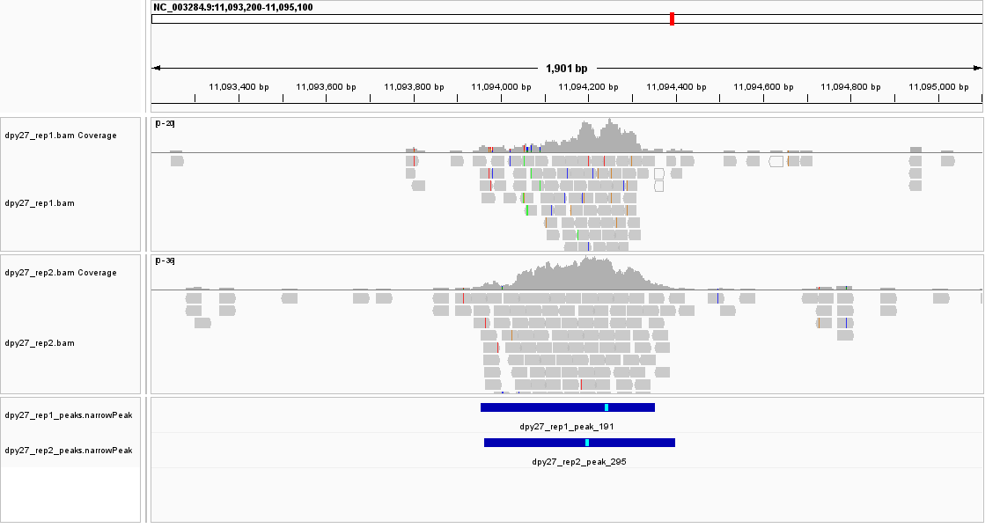
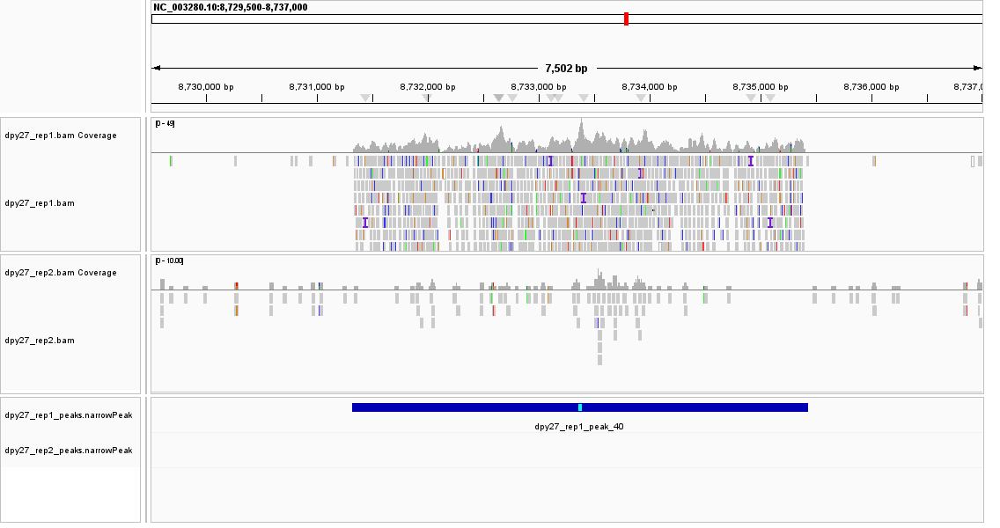

# Week 10 - ChIP-seq peak calling (C. elegans DPY-27)

## Assignment
This week adapts the Week 9 alignment workflow to call **ChIP-seq peaks**.

- **Assay:** ChIP-seq (chromatin-protein binding)
- **Organism:** *Caenorhabditis elegans*, mixed-stage embryos
- **Study / BioProject:** SRP000708
- **Target:** DPY-27, a subunit of the dosage compensation complex (DCC), which binds and down-regulates both X chromosomes in hermaphrodites.
- **Control:** input chromatin from the same embryos.
- **Design:** 2 replicates per group (ChIP vs input).

| sample | group | run | control |
|---|---|---|---|
| dpy27_rep1 | chip | SRR015070 | input_rep1 |
| dpy27_rep2 | chip | SRR015072 | input_rep2 |
| input_rep1 | input | SRR015071 | - |
| input_rep2 | input | SRR015073 | - |

Each ChIP replicate is paired with its own input in `design.csv`, so MACS2 uses the matched background.

## Workflow
1. Download + index the genome (WBcel235, GCF_000002985.6) with `bwa index` + `samtools faidx`.
2. Align each single-end run with `bwa mem`. These are old Genome Analyzer tags (rep1 = 27 bp, rep2 = 34 bp). `bwa mem`'s default output-score threshold is `-T 30`; a 27 bp read can score at most 27, so **every** rep1 alignment would be silently discarded (0% mapped). We set **`-T 20`** uniformly so genuine short-read alignments survive.
3. Sort + index BAMs.
4. Call peaks per ChIP sample against its matched input: `macs2 callpeak -t <chip> -c <input> -f BAM -g 9e7`.
5. Count peaks (narrowPeak lines) per sample.

Read budget: `N = 3,000,000` reads/run (first N via `fastq-dump`)

## Results - peaks per sample
| ChIP sample | control | peaks | % on chrX |
|---|---|---|---|
| dpy27_rep1 | input_rep1 | 229 | 40% (91/229) |
| dpy27_rep2 | input_rep2 | 370 | 51% (187/370) |

Mapping rate: rep1 18.3% (lower, from the shorter 27 bp reads), rep2 higher with 34 bp reads.

chrX is only ~18% of the genome, so **40-51% of peaks on X is a ~2-3 times enrichment** - the expected DPY-27 dosage-compensation signature, reproduced in both replicates.

## Replicate consistency (IGV)
Tracks top→bottom: rep1 coverage, rep1 reads, rep2 coverage, rep2 reads, then both peak tracks.

**Agreement** - chrX `NC_003284.9:11,093,952-11,094,352`, the strongest shared peak (signalValue ≈ 28). Both replicates show a sharp, overlapping peak over matched input (`dpy27_rep1_peak_191` / `dpy27_rep2_peak_295`).

**Disagreement** - chr II `NC_003280.10:8,731,307-8,735,434`, a strong rep1-only peak (`dpy27_rep1_peak_40`, signalValue ≈ 31) with no corresponding call in rep2. An autosomal call not reproduced in the second replicate - consistent with a replicate-specific artifact rather than true DCC binding, which targets X.

## Tools not in the default bioinfo environment
- **MACS2** - cannot be installed into the `bioinfo` env (it pins Python 3.12; MACS2 needs ≤ 3.11). Installed into a dedicated env:

      micromamba create -n macs -c bioconda -c conda-forge macs2 -y

  and invoked as `micromamba run -n macs macs2` (the `MACS` variable in the Makefile).

All other tools (`bwa`, `samtools`, `bedtools`, `sra-tools`) are in the default `bioinfo` env.

## Reproducing this analysis

    micromamba activate bioinfo
    cd week10
    make all          # genome -> align -> peaks -> count

Outputs: `bam/*.bam` (+ `.bai`), `peaks/*_peaks.narrowPeak`, and per-sample peak counts. Large data (`refs/`, `reads/`, `bam/`, `peaks/`, `*.sra`) is gitignored; only `Makefile`, `design.csv`, `README.md`, `.gitignore`, and the `img/` screenshots are tracked.
