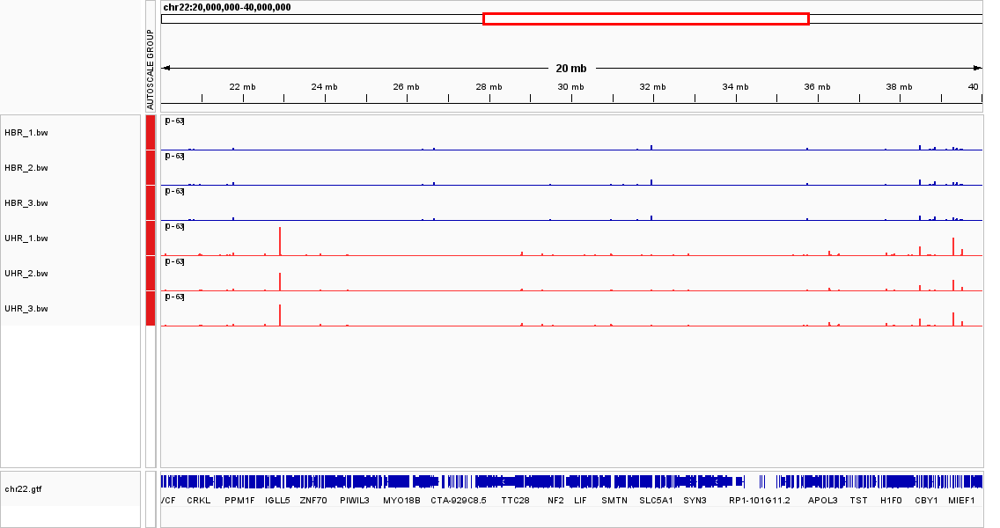
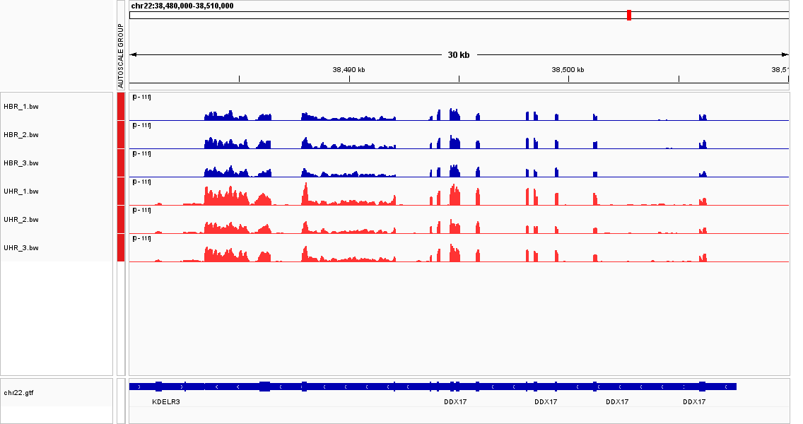
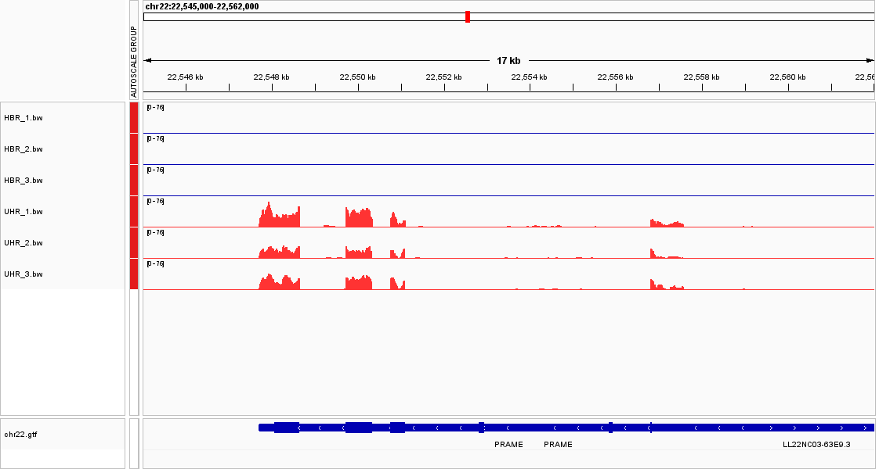
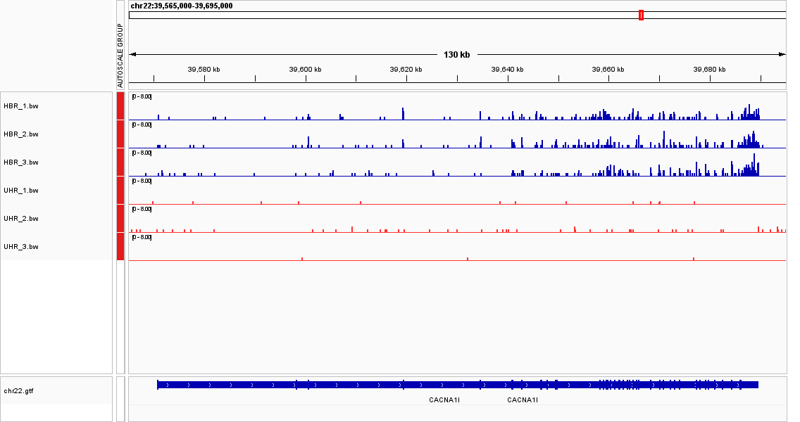

# Week 11 - Genome-based RNA-Seq: Evaluate gene expression

## Assignment
Align RNA-Seq reads to the genome, generate per-sample coverage tracks, and use IGV to compare gene expression between two reference RNA samples.

- **Assay:** RNA-Seq (single-end, Illumina 100 bp)
- **Data:** chr22-only tutorial subset, from `data.biostarhandbook.com/data/rnaseq-tutorial-2026.tar.gz`
- **Sample types (3 replicates each):**
  - **UHR** - Universal Human Reference: total RNA from a pool of 10 cancer cell lines
  - **HBR** - Human Brain Reference: total RNA isolated from human brains
- **Reference:** `chr22.genome.fa` (GRCh38 chr22); annotation `chr22.gtf`

## Workflow
1. **Index** the genome with HISAT2 (a splice-aware aligner - RNA-Seq reads can span exon-exon junctions).
2. **Align** each sample with `hisat2 --sensitive`, sort/index with `samtools`.
3. **Coverage:** `bamCoverage` (deeptools) → a bigWig per sample for IGV.
4. **Count:** `featureCounts -s 2` (the TruSeq libraries are reverse-stranded) → reads per gene.
5. **Batch** all six samples via `make batch` (GNU parallel over `design.csv`).

`make index` → `make align` → `make batch`. HBR_1 overall alignment rate ≈ 53% (a chr22-only read subset).

## Tools not in the default bioinfo environment
These were installed into a dedicated `rnaseq` env, and the RNA-Seq
stack needs a newer `samtools` than the env would otherwise solve to:

    micromamba create -n rnaseq -c conda-forge -c bioconda \
      "samtools>=1.18" hisat2 subread deeptools parallel make -y

- **HISAT2** - splice-aware RNA-Seq aligner
- **subread** - provides `featureCounts`
- **deeptools** - provides `bamCoverage` (bigWig generation)
- **parallel**, **make**, **samtools ≥1.18** - pipeline drivers (samtools in `bioinfo` was too old for `--write-index`)

## Library sizes (reads assigned to chr22 genes)
| HBR_1 | HBR_2 | HBR_3 | UHR_1 | UHR_2 | UHR_3 |
|---|---|---|---|---|---|
| 39,289 | 48,402 | 42,844 | 67,210 | 43,818 | 53,725 |

Library sizes differ (UHR_1 is ~1.7 times HBR_1), so coverage is not directly comparable between samples - fold-changes below use **CPM-normalized** counts.

---

## The questions

**Tracks in IGV:** six `bw/*.bw` coverage tracks (HBR blue, UHR red) + `chr22.gtf`, with **Group Autoscale** on so all six share one y-axis.

### 1. Wide view - how are the two sample types different?
At the megabase scale both types light up a shared backbone of broadly-expressed genes, but each type also switches **on a distinct set of genes the other lacks**. UHR peaks appear at genes that are flat in HBR (e.g. the immunoglobulin λ locus, PRAME), while HBR peaks appear at neuronal genes flat in UHR (e.g. CACNA1I). Of 1,371 annotated chr22 genes, 827 are expressed in at least one sample, and a large fraction of those are type-specific - the two groups separate cleanly by which genes are on.

### 2. How consistent are the replicates?
Very consistent within a type. The three HBR tracks track each other and the three UHR tracks track each other, both for level and for which genes are on/off. Examples (raw counts):
- MAPK1 - HBR `738, 950, 900` , UHR `834, 497, 663` (same ballpark; within-group CV ≈ 0.2)
- PRAME - HBR `0, 0, 0` , UHR `814, 464, 600` (unanimously off vs unanimously on)

After CPM normalization (needed because library sizes differ) the replicates agree closely; between-type differences are far larger than within-type scatter.

### 3. A gene not expressed in any sample
**544 of 1,371 genes** have zero reads in all six samples (e.g. `ENSG00000277248`). In IGV the GTF shows the gene model but all six coverage tracks are flat over it. Most are non-coding or simply not transcribed in brain or these cancer lines.

### 4. A gene very strongly expressed in all samples - its coverage
**DDX17** (`ENSG00000100201`, chr22:38,483,438-38,507,660), a DEAD-box RNA helicase. It has the highest floor of any gene - expressed in every sample (counts 1,532-2,808; CPM ≈ 29,000-42,000), so its exons form a tall, continuous coverage pileup in all six tracks. (MAPK1/ERK2 is the most *uniform* across replicates.) With all six tracks on a shared (group) autoscale, the DDX17 coverage peaks at **~11 reads deep** over its exons - the tallest signal in that window and the pileup is present in every sample.

### 5. Can you identify the transcripts that are expressed?
Only partly. Coverage follows exon boundaries, so you can confirm a gene is transcribed and often which exons are used, but single-end short-read coverage alone usually can't pinpoint **which isoform** among overlapping transcripts in the GTF is responsible. We can **exclude** candidates whose unique exons show no coverage, yet when isoforms share most exons we can't uniquely assign the signal.

### 6. A gene clearly different between the two types and fold change
Two examples:

- **PRAME** (`ENSG00000185686`, chr22:22,547,701-22,559,361) - **UHR-specific**. Raw counts HBR `0, 0, 0` vs UHR `814, 464, 600`: **effectively a >1000-fold change**.
- **CACNA1I** (`ENSG00000100346`, chr22:39,570,753-39,689,735) - **HBR-specific**. Raw counts HBR `105, 137, 135` vs UHR `2, 2, 0`: **~110-fold higher in HBR**.

### 7. Upregulated or downregulated?
- **PRAME:** upregulated in **UHR** (silent in HBR).
- **CACNA1I:** upregulated in **HBR** (silent in UHR).

### 8. How certain is it that this is not a random fluctuation?
Highly certain. The difference is **unanimous across all three independent replicates** in each group with no overlap between groups (PRAME `0/0/0` vs `814/464/600`; CACNA1I `105/137/135` vs `2/2/0`). The effect size is far larger than the within-group replicate scatter, and it survives library-size (CPM) normalization. A random fluctuation would not be this large and reproduced in every replicate. A formal DESeq2 test would quantify significance, but the replicate agreement alone is conclusive here.

---

## Reproducing this analysis

    micromamba activate rnaseq
    cd week11
    curl -sSL http://data.biostarhandbook.com/data/rnaseq-tutorial-2026.tar.gz | tar xzvf -
    curl -fsSL https://data.biostarhandbook.com/make/rnaseq.hisat.2026.mk > Makefile
    make index
    make batch            # align + coverage + counts for all 6 samples

Outputs: `bam/*.bam`, `bw/*.bw` (IGV coverage), `counts/*.txt`. Then load `fasta/chr22.genome.fa`,
the six `bw/*.bw`, and `gtf/chr22.gtf` into IGV (Group Autoscale on; color HBR vs UHR).
Large/regenerable data (`fasta/`, `fastq/`, `gtf/`, `bam/`, `bw/`, `counts/`, `*.tar.gz`) is gitignored;
only `Makefile`, `design.csv`, `README.md`, `.gitignore`, and `img/` screenshots are tracked.
